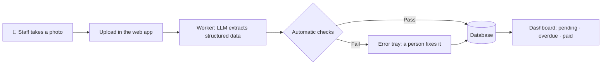

# Invoice & Delivery Note Tracker

A web app that lets a restaurant stop tracking supplier paperwork in a spreadsheet. Staff snap a photo of an invoice or delivery note, an LLM pulls the data out of it, and the app keeps each supplier's account up to date: what's **pending**, **overdue** and **paid**.

> 🚧 **Status: early development.** The system is being designed and built for a real restaurant in Buenos Aires, Argentina. Expect breaking changes.

---

## The problem

The restaurant receives supplier documents every week: printed invoices, handwritten delivery notes (*remitos*), and the occasional credit note. Today all of it goes into an Excel sheet by hand. That's slow, error-prone, and makes it hard to answer simple questions like *"what do we owe this week?"* or *"how much did we spend on this supplier last month?"*

## How it works



1. **Capture** – A staff member photographs the document with their phone. The browser compresses the image lightly and uploads it, and it's stored before anything else happens, so a dropped connection doesn't lose the document.
2. **Extract** – A background worker picks up the job and sends the image to a vision-capable LLM, which returns structured data: supplier, document type, dates, line items, taxes and totals.
3. **Validate** – Deterministic checks look for missing data, totals that don't add up, invalid CUITs and duplicates.
4. **Review** – Documents that fail a check go to an error tray, where a person fixes them. Documents that pass are usable right away as *Sin revisar*, and someone can mark them *Revisado* later.
5. **Track** – Documents and payments feed each supplier's account, where they can be filtered and searched. A payment can be applied to one document or many.

## Features

**MVP**
- Photo upload of invoices, delivery notes and credit notes
- Background LLM extraction with automatic validation
- Review states: *Error*, *Sin revisar* and *Revisado*
- Manual entry of documents, including each supplier's opening balance
- Dashboard with pending, overdue and total debt per supplier
- Payments that can settle many documents, in full or in part, and credit on account
- A single login for the restaurant

**Planned** — see [Roadmap](#roadmap).

## Design decisions

A few choices worth explaining:

- **"Documents", not "invoices."** The core entity is a generic *document* with a type (`invoice`, `delivery_note`, `credit_note`, `opening_balance`). Delivery notes turned out to be as important as invoices, and they don't always look like one, so modeling everything as "an invoice with a status" would have broken quickly.
- **Payments are separate from documents.** Suppliers work on a running account: one eCheq can pay several invoices, one invoice can take several payments, and leftovers stay as credit. So a payment belongs to a supplier, and an *application* links part of it to a document. Credit notes settle documents the same way.
- **Payment status is derived, not stored.** There's no nightly cron job flipping statuses. Status is calculated at read time from what's been applied to the document:
  - nothing left to pay → `paid`
  - money left and the due date is in the past → `overdue`
  - otherwise → `pending`

  One less moving part, and the status can never go stale.
- **LLM extraction instead of parsing QR codes.** Argentine electronic invoices include a QR code with some of the data, but delivery notes don't, and the QR doesn't carry line items or due dates anyway. Photos taken by hand + an LLM cover every document type with a single pipeline.
- **Checks decide, a person reviews when it matters.** The model's output is a *suggestion*, and deterministic checks decide what happens to it. Anything that fails waits for a person. Anything that passes counts right away but stays marked *Sin revisar*, so the daily work doesn't depend on reviewing every document.
- **Due dates come from the supplier's term.** The date printed next to the CAE looks like a due date but isn't one, and several invoices print nothing else. So a due date is always the issue date plus the term agreed with the supplier. A new supplier's first document waits in the error tray until someone sets that term.
- **One restaurant, one account.** No multi-tenancy and no roles. A second restaurant would be a separate deployment.
- **Spanish UI.** The project's UI and everything the user sees must be in Spanish: screens, labels, buttons, validation and error messages, and notifications. Internal identifiers like `paid` or `delivery_note` are never shown as-is; they're displayed in Spanish (e.g. *Pagado*, *Remito*).
- **Web app first.** The original idea was a WhatsApp bot as the input channel. A web app covers the same workflow with less setup (no Meta Business account, no dedicated phone number) and gives the restaurant a proper dashboard from day one.

## Tech stack

| Layer      | Tech                                   |
| ---------- | -------------------------------------- |
| Backend    | NestJS (TypeScript)                    |
| Frontend   | React + Vite (TypeScript)              |
| Database   | PostgreSQL + Prisma                    |
| Extraction | Claude Haiku 5.5 (Claude API) with structured output |
| Jobs       | Job table in PostgreSQL + worker process |
| Infra      | Docker, Nginx (reverse proxy), Certbot (HTTPS), VPS |

## Project structure

```
.
├── backend/            # NestJS API
├── frontend/           # React + Vite app
├── plans/              # Implementation plans
├── docker-compose.yml
├── system-design.md    # Data model, pipeline and validation rules
├── one-way-doors.md    # Changes that need a thorough human review
├── agents.md           # Orientation for coding agents
├── codingStandards.md  # Rules used for code review
└── README.md
```

## Getting started

### Prerequisites

- Node.js 20+
- Docker and Docker Compose
- A Claude API key

### 1. Clone and configure

```bash
git clone <repo-url>
cd <repo-name>
cp .env.example .env
```

Fill in `.env`:

| Variable        | Description                              |
| --------------- | ---------------------------------------- |
| `DATABASE_URL`  | PostgreSQL connection string             |
| `ANTHROPIC_API_KEY` | Claude API key used for extraction   |
| `LLM_MODEL`     | Model used for extraction (`claude-haiku-5-5`) |
| `JWT_SECRET`    | Secret used to sign auth tokens          |
| `UPLOAD_DIR`    | Where uploaded document images are stored |
| `RESTAURANT_CUIT` | The restaurant's CUIT, used to detect documents addressed to someone else |

### 2. Run with Docker

```bash
docker compose up --build
```

### 3. Or run locally

```bash
# Database
docker compose up -d db

# Backend
cd backend
npm install
npx prisma migrate dev
npm run start:dev

# Extraction worker (in another terminal)
cd backend
npm run start:worker

# Frontend (in another terminal)
cd frontend
npm install
npm run dev
```

## Deployment

The app runs on a VPS with Docker Compose. Nginx sits in front as a reverse proxy, Certbot handles HTTPS certificates, and the extraction worker runs in its own container.

## Development workflow

Code review follows the rules in [`codingStandards.md`](./codingStandards.md), an approach inspired by Matt Pocock's talk *"Fixing the PR Bottleneck"*: the standards are written down once, so every review (human or AI-assisted) checks against the same explicit list instead of relying on memory.

## Roadmap

- [ ] **MVP** – upload, extraction, validation and review, manual entry, supplier accounts, payments
- [ ] Due-date reminders (e.g. "3 invoices are due tomorrow")
- [ ] Spending reports per supplier and per month
- [ ] Filters and reports by tax (IVA and perceptions are stored from day one)
- [ ] Link delivery notes to the invoice that bills them
- [ ] Cost and profitability per dish (recipes, ingredients, unit conversion)

## Author

Built by **Luca Avila**.
