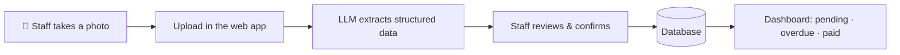

# Invoice & Delivery Note Tracker

A web app that lets a restaurant stop tracking supplier paperwork in a spreadsheet. Staff snap a photo of an invoice or delivery note, an LLM pulls the data out of it, and the app keeps track of what's **pending**, **overdue** and **paid**.

> 🚧 **Status: early development.** The system is being designed and built for a real restaurant in Buenos Aires, Argentina. Expect breaking changes.

---

## The problem

The restaurant receives supplier documents every week: printed invoices, handwritten delivery notes (*remitos*), and the occasional credit note. Today all of it goes into an Excel sheet by hand. That's slow, error-prone, and makes it hard to answer simple questions like *"what do we owe this week?"* or *"how much did we spend on this supplier last month?"*

## How it works



1. **Capture** – A staff member photographs the document with their phone and uploads it.
2. **Extract** – A vision-capable LLM reads the photo and returns structured data: supplier, document type, dates, line items and totals.
3. **Review** – The extracted data is shown back to the user before anything is saved. Handwritten notes and blurry photos *will* produce mistakes, so a person always has the final word.
4. **Track** – Confirmed documents show up in the dashboard, where they can be filtered, searched and marked as paid.

## Features

**MVP**
- Photo upload of invoices, delivery notes and credit notes
- LLM-powered data extraction with a review/confirm step
- Dashboard with pending, overdue and paid documents
- Mark documents as paid
- Access restricted to authorized restaurant staff

**Planned** — see [Roadmap](#roadmap).

## Design decisions

A few choices worth explaining:

- **"Documents", not "invoices."** The core entity is a generic *document* with a type (`invoice`, `delivery_note`, `credit_note`). Delivery notes turned out to be as important as invoices, and they don't always look like one, so modeling everything as "an invoice with a status" would have broken quickly.
- **Payment status is derived, not stored.** There's no nightly cron job flipping statuses. Status is calculated at read time:
  - has a payment date → `paid`
  - due date is in the past → `overdue`
  - otherwise → `pending`

  One less moving part, and the status can never go stale.
- **LLM extraction instead of parsing QR codes.** Argentine electronic invoices include a QR code with some of the data, but delivery notes don't, and the QR doesn't carry line items or due dates anyway. Photos taken by hand + an LLM cover every document type with a single pipeline.
- **Human in the loop.** The model's output is a *suggestion*. Nothing reaches the restaurant's books without someone confirming it.
- **Spanish UI.** The project's UI and everything the user sees must be in Spanish: screens, labels, buttons, validation and error messages, and notifications. Internal identifiers like `paid` or `delivery_note` are never shown as-is; they're displayed in Spanish (e.g. *Pagado*, *Remito*).
- **Web app first.** The original idea was a WhatsApp bot as the input channel. A web app covers the same workflow with less setup (no Meta Business account, no dedicated phone number) and gives the restaurant a proper dashboard from day one.

## Tech stack

| Layer      | Tech                                   |
| ---------- | -------------------------------------- |
| Backend    | NestJS (TypeScript)                    |
| Frontend   | React + Vite (TypeScript)              |
| Database   | PostgreSQL + Prisma                    |
| Extraction | Vision-capable LLM with structured output |
| Infra      | Docker, Nginx (reverse proxy), Certbot (HTTPS), VPS |

## Project structure

```
.
├── backend/            # NestJS API
├── frontend/           # React + Vite app
├── docker-compose.yml
├── codingstandards.md  # Rules used for code review
└── README.md
```

## Getting started

### Prerequisites

- Node.js 20+
- Docker and Docker Compose
- An API key for the LLM provider used for extraction

### 1. Clone and configure

```bash
git clone <repo-url>
cd <repo-name>
cp .env.example .env
```

Fill in `.env`:

| Variable        | Description                              |
| --------------- | ---------------------------------------- |
| `DATABASE_URL`  | PostgreSQL connection string             |
| `LLM_API_KEY`   | API key for the extraction model         |
| `LLM_MODEL`     | Model used for extraction                |
| `JWT_SECRET`    | Secret used to sign auth tokens          |
| `UPLOAD_DIR`    | Where uploaded document images are stored |

### 2. Run with Docker

```bash
docker compose up --build
```

### 3. Or run locally

```bash
# Database
docker compose up -d db

# Backend
cd backend
npm install
npx prisma migrate dev
npm run start:dev

# Frontend (in another terminal)
cd frontend
npm install
npm run dev
```

## Deployment

The app runs on a VPS with Docker Compose. Nginx sits in front as a reverse proxy, and Certbot handles HTTPS certificates.

## Development workflow

Code review follows the rules in [`codingstandards.md`](./codingstandards.md), an approach inspired by Matt Pocock's talk *"Fixing the PR Bottleneck"*: the standards are written down once, so every review (human or AI-assisted) checks against the same explicit list instead of relying on memory.

## Roadmap

- [ ] **MVP** – upload, extraction, review, dashboard, mark as paid
- [ ] Import the restaurant's existing Excel data
- [ ] Due-date reminders (e.g. "3 invoices are due tomorrow")
- [ ] Spending reports per supplier and per month
- [ ] Link delivery notes to the invoice that bills them
- [ ] Cost and profitability per dish (recipes, ingredients, unit conversion)

## Author

Built by **Luca Avila**.
