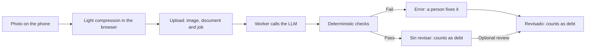
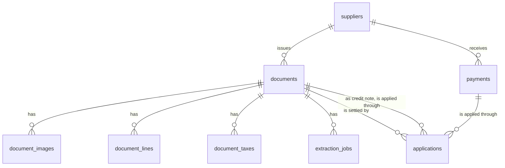

# System design

> **Status:** agreed for the MVP, 2026-11-06. Decision 5 revised to individual accounts, 2026-11-07. This is the working document for the design: iterate here, and let `plans/` turn it into work. If it disagrees with the README, this file wins.
>
> **This repo is public.** Never write real supplier names, CUITs or amounts here or in any other committed file.

## Evidence

Two sources shaped this design:

- **Five real photos** in `samples/` (gitignored): four type A invoices and one printed delivery note.
- **The restaurant's current spreadsheet** (kept outside the repo): one sheet per supplier, 57 suppliers, about 115 documents a month.

| Seen in the data | Consequence for the design |
| --- | --- |
| One eCheq pays several invoices, the remainder rolls over, and one invoice can take two eCheqs | Payments and documents are many-to-many, through `applications` |
| Credit notes and credit balances are applied like payments | `applications` accepts a credit note as its source |
| About 80% of paid rows are transfers and about 15% are eCheqs, which have a number and a date of their own | `payments` has `method`, `reference` and `value_date` |
| At least 37 of 57 sheets state a payment term, from 7 to 60 days | `suppliers.payment_term_days` |
| 2 of 4 invoices print no payment due date, only the CAE expiry, labelled "Vence" or "VTO" | Printed dates aren't used. See [Due dates](#due-dates) |
| The delivery note has no number, no prices and no taxes, only an insured amount. The spreadsheet booked that same amount as debt | A delivery note's `total` can be its insured amount. Duplicate checks can't rely on the number |
| Line totals exclude tax on 3 invoices and include it on 1 | The sum of lines may match either `subtotal` or `total` |
| Quantity is printed twice (units and kg, `1x12` and `12`), and one unit price already includes its discount | No per-line `quantity × unit_price` check |
| Tax blocks vary: one or two IVA rates, IVA and IIBB perceptions | Taxes are rows, not columns |
| Three number formats across five documents: `1.234,56`, `1,234.56`, `1234.56` | The LLM returns canonical decimal strings |
| Document numbers come in several shapes, and CUITs appear with and without hyphens | Keep the printed `number` and a digits-only `number_normalized`. CUITs are stored as 11 digits |
| The restaurant's name on documents varies, its CUIT doesn't | Match the recipient by CUIT only |
| A supplier's legal name can be unrelated to the name the restaurant uses | `suppliers` has `name` and `legal_name` |
| The same total repeats across a supplier's invoices on different days | Never treat equal amounts alone as a duplicate |
| Pen marks, highlighter, tick marks, shadows, curved pages and binder rings; text from the next page shows through | The prompt must ignore them. Keep enough resolution |
| 900×1600 photos of 140–280 KB, already compressed by WhatsApp, keep small print legible to the eye | 2200 px leaves headroom. To be confirmed with the extraction test |

**Sample gaps:** no credit note, handwritten delivery note, type B or C invoice, multi-page document or uncompressed photo yet.

## Decisions

1. **One purchase, one document (MVP assumption).** Some delivery notes have an invoice and others don't, but for the MVP only one of the two gets uploaded. The app doesn't link them. This depends on how the app is used: if both are uploaded, `duplicate_suspected` only catches them when date and total match.
2. **Payments are independent from documents.** A payment belongs to a supplier. `applications` says which documents it settles, so unapplied money is simply credit on the account. A deferred eCheq counts as paid when it's handed over.
3. **Upload first, extract later.** The image is stored before anything else happens, and a worker processes a job table in Postgres.
4. **Validation decides, review is optional.** Documents that pass every check are usable right away as *Sin revisar*. Documents that fail go to the *Error* tray. This replaces "nothing is saved until someone confirms": a misread that passes every check reaches the balance unseen, which is why the checks are explicit and *Sin revisar* stays visible.
5. **Single tenant, one account per person.** No `restaurant_id`. Each person signs in with their own account, so documents, payments and `audit_log` record who did what. `users.role` exists from day one, but every role has full access in the MVP. A script on the server creates accounts and resets passwords: no sign-up and no email. Another restaurant, whether sold to someone else or run by the same owner, means another deployment with its own database, not another row in `users`. Multi-tenancy is postponed on purpose, see [`one-way-doors.md`](one-way-doors.md#postponed-on-purpose).
6. **Manual entry instead of importing the spreadsheet.** The spreadsheet's dates and numbers aren't reliable enough to import: dates mix formats and many have day and month swapped, and document numbers are truncated. Opening debt is typed in as up to two `opening_balance` documents per supplier, one for what's overdue and one for what isn't, so the dashboard keeps that split from day one.
7. **Store tax and line detail now.** It costs little at extraction time and enables filters and reports after the MVP.
8. **Claude Haiku 5.5 for extraction**, through the Claude API with the official TypeScript SDK.
9. **Only this restaurant's documents.** The owner's other restaurants don't enter the app.

## Flow



### Review status

| Status | UI label | Meaning | Counts as debt |
| --- | --- | --- | --- |
| `processing` | Procesando | Waiting for extraction | No |
| `error` | Error | Needs a person: see `issues` | No, shown apart |
| `unreviewed` | Sin revisar | Passed every check, nobody looked at it | Yes |
| `reviewed` | Revisado | A person confirmed it, or typed it in | Yes |

- Manual documents start as `reviewed`, by the person who typed them in.
- Saving an edit runs the checks again. If they pass, or the remaining issues are accepted, the document becomes `reviewed`, by the person who saved it.
- `reviewed_by` and `reviewed_at` always hold the last person who confirmed the data, and when.
- `reviewed` never goes back to `error`.
- The UI marks *Sin revisar* quietly. It blocks nothing: these documents can take payments as usual.
- `error` documents can't take payments, because their supplier or total may still change.
- The balance excludes `error` documents, so the dashboard always warns how many there are and how much they add up to.

## Data model



Money is `numeric(14,2)`, never a float. Timestamps are `timestamptz`. Every table has `id uuid` and `created_at`; tables with mutable rows also have `updated_at`.

```text
suppliers
  name               text, not null        what the restaurant calls them
  legal_name         text                  razón social as printed
  cuit               char(11), unique      digits only; null only for informal suppliers
  payment_term_days  int, >= 0             null = not set yet, 0 = pays on delivery
  notes              text

documents
  type               enum                  invoice | delivery_note | credit_note | opening_balance
                                           null until extracted
  source             enum, not null        upload | manual
  review_status      enum, not null        processing | error | unreviewed | reviewed
  issues             jsonb, not null       open and accepted validation issues
  supplier_id        fk suppliers
  letter             text                  A, B, C, M, X
  number             text                  as printed
  number_normalized  text                  digits only
  issue_date         date
  due_date           date                  the one every derived status uses
  due_date_source    enum                  supplier_term | manual
  subtotal           numeric(14,2)
  total              numeric(14,2)         always positive, type gives the sign
  cae                text
  notes              text
  created_by         fk users, not null    who uploaded it or typed it in
  reviewed_at        timestamptz
  reviewed_by        fk users
  deleted_at         timestamptz           soft delete

document_images
  document_id        fk documents, not null
  position           int, not null         page order, unique per document
  storage_key        text, not null
  mime_type          text, not null
  width, height      int, not null
  size_bytes         int, not null
  sha256             char(64), not null

document_lines
  document_id        fk documents, not null
  position           int, not null
  product_code       text
  description        text, not null
  quantity           numeric(14,3)         the figure the price multiplies
  unit               text                  kg, un, lt
  package_text       text                  as printed: 1x12
  unit_price         numeric(16,4)
  iva_rate           numeric(5,2)
  discount_pct       numeric(5,2)
  line_total         numeric(14,2)         as printed, may include tax

document_taxes
  document_id        fk documents, not null
  kind               enum, not null        iva | iva_perception | iibb_perception | other
  label              text, not null        as printed
  rate               numeric(5,2)
  base               numeric(14,2)
  amount             numeric(14,2), not null

payments
  supplier_id        fk suppliers, not null
  amount             numeric(14,2), not null, > 0
  paid_on            date, not null        when it was paid or the eCheq was handed over
  value_date         date                  when a deferred eCheq can be cashed
  method             enum, not null        transfer | echeq | cash | mercado_pago | other
  reference          text                  eCheq number, transfer id
  notes              text
  created_by         fk users, not null    who recorded it
  deleted_at         timestamptz

applications
  document_id        fk documents, not null   the debt being settled
  payment_id         fk payments              exactly one of payment_id, credit_note_id
  credit_note_id     fk documents
  amount             numeric(14,2), not null, > 0

extraction_jobs                               re-extracting adds a row, so history is kept
  document_id        fk documents, not null
  status             enum, not null        queued | running | succeeded | failed
  attempts           int, not null
  run_after          timestamptz, not null retry backoff
  locked_until       timestamptz           an expired lease means the worker died
  model              text
  prompt_version     text
  raw_output         jsonb                 exactly what the LLM returned, never edited
  last_error         text

audit_log
  user_id            fk users              null when the worker made the change
  entity             text, not null
  entity_id          uuid, not null
  action             text, not null
  before, after      jsonb

users                                         created by a script, no sign-up
  email              text, unique, not null
  name               text, not null        shown as who uploaded, reviewed or paid
  password_hash      text, not null
  password_set_at    timestamptz, not null sessions issued before it are rejected
  role               enum, not null        admin | staff, not enforced in the MVP
  disabled_at        timestamptz           can't sign in; users are never deleted
```

### Invariants

Checked in the database where possible. Some `CHECK` constraints and partial unique indexes may need hand-written SQL in the Prisma migration.

1. A document in `unreviewed` or `reviewed` has `type`, `supplier_id`, `issue_date` and `total`. Invoices and delivery notes also have `due_date`.
2. Applications to a document never exceed its `total`.
3. Applications from a payment or credit note never exceed its amount. Rules 2 and 3 run in a transaction that locks the rows involved.
4. An application's document and its source belong to the same supplier.
5. Only `invoice`, `delivery_note` and `opening_balance` receive applications. Only payments and `credit_note` documents provide them.
6. While a document has applications, it can't be deleted, can't change supplier or type, and its `total` can't drop below what was applied.
7. A non-deleted document in `unreviewed` or `reviewed` is unique by supplier, type, letter and `number_normalized`, when it has a number.
8. `reviewed_at` and `reviewed_by` are set if and only if the document is `reviewed`.

An opening balance in the restaurant's favor is a manual `credit_note`, because that's how it behaves: credit that can be applied later.

## Derived values

Nothing here is stored. Backend queries compute it at read time, because filters and totals have to cover every document, not just the page the frontend loaded.

```text
applied(document)      = Σ applications.amount received
outstanding(document)  = total − applied(document)

status(document)       = paid     if outstanding = 0
                         overdue  if outstanding > 0 and due_date < today
                         pending  otherwise

unapplied(payment)     = amount − Σ applications.amount given
unapplied(credit_note) = total − Σ applications.amount given

supplier.not_due       = Σ outstanding of pending documents
supplier.overdue       = Σ outstanding of overdue documents
supplier.credit        = Σ unapplied(payments) + Σ unapplied(credit notes)
supplier.balance       = not_due + overdue − credit
```

- These sums cover documents in `unreviewed` or `reviewed` that aren't deleted.
- `today` is the date in `America/Argentina/Buenos_Aires`. A document due today isn't overdue.
- Status applies to the document types that receive applications. Credit notes show *Disponible* or *Aplicada* instead.
- A partly paid document keeps its status, and the UI adds a *Pago parcial* badge with what's left.
- An opening balance with no due date stays pending.

## Due dates

The supplier's term is the source of truth, as confirmed by the restaurant:

```text
due_date = issue_date + suppliers.payment_term_days
```

- It applies to invoices and delivery notes. Credit notes and opening balances don't need a term.
- It's resolved once and stored, so changing a term doesn't touch existing documents.
- A supplier without a term sends the document to `error` with `supplier_term_missing`, so a new supplier's first document always stops there. A person sets the term once, which also re-checks that supplier's other stuck documents.
- The tray suggests a term from what's printed on the document, read from `raw_output`, but a person always confirms it.
- A person can override the date of a single document (`manual`).

Printed dates aren't used, and the samples show why. The term landed within a day of the date the restaurant actually uses in all five, and the printed date didn't:

| Sample | Printed payment date | CAE expiry vs date in use | Supplier term vs date in use |
| --- | --- | --- | --- |
| `factura-a-01` | Matches | 5 days early | Matches |
| `factura-a-02` | 4 days early | 4 days early | Matches |
| `factura-a-03` | None | 10 days early | Matches |
| `factura-a-04` | None | 21 days early | 1 day off |
| `remito-x-01` | None | No CAE | 1 day off |

The 1-day differences are because the spreadsheet treats 30 days as "same day next month". This design uses plain days.

This rule also removes the riskiest misread in the pipeline. A CAE expiry mistaken for a due date passes every sum, so a document would look overdue weeks early. With one rule, the LLM's reading of dates never reaches `due_date` without a person confirming the term.

## Extraction

**Capture.** Compress in the browser with a library such as `browser-image-compression`:

- Long side up to 2200 px, JPEG quality around 0.85. Haiku 5.5 reads up to 2,576 px and 4,784 visual tokens and downscales anything larger. On a 3:4 phone photo the token limit comes first: 2200 px fits, and 2400 px would be shrunk again by the API.
- Apply EXIF orientation. No grayscale, thresholding or sharpening.
- If compression fails, upload the original when it's JPEG, PNG or WebP and under 7 MB. Otherwise, reject it with a clear message. The API takes up to 10 MB per image after base64 encoding, and it doesn't accept HEIC.

**Upload.** One document can take several photos. Files are written to `UPLOAD_DIR`, then one transaction creates the document, its images and its job. Images are served through an authenticated endpoint, never as public static files. The server stores and sends the bytes as they arrive, because each extra lossy pass hurts legibility.

**Worker.** A separate container from the backend image, running one job at a time. Volume is about five documents a working day, so there's no need for Redis or concurrency. It claims jobs with `FOR UPDATE SKIP LOCKED`, holds a lease in `locked_until`, and retries three times with backoff before ending in `extraction_failed`. Those are the only retries: set `maxRetries: 0` in the SDK so they don't multiply.

**Call.** `client.messages.parse()` from `@anthropic-ai/sdk`, with a Zod schema through `output_config: { format: zodOutputFormat(schema) }`, and the images before the text. The model comes from `LLM_MODEL` (`claude-haiku-5-5`).

- Set `output_config.effort` explicitly. Haiku's default is `medium`, and the extraction test decides the level.
- Thinking is on by default and counts toward `max_tokens`. Use around 16,000 so a long invoice doesn't get cut off.
- Don't send `temperature`, `top_p` or `top_k`: they return a 400.
- An attempt fails if `stop_reason` is `max_tokens` or `refusal`, or if `parsed_output` is null. Haiku has no server-side fallback for refusals, so that document ends in `extraction_failed`.

Estimated cost is about US$0.002 per document, or about US$3 a year at current volume. Measure it from `usage` in the extraction test.

**Prompt.** The schema mirrors the tables above. Numbers are decimal strings, dates are ISO, and anything unreadable is `null`, never a guess. The prompt must say that the CAE expiry is not a payment due date, and it must ignore handwriting, highlighter and text showing through from other pages.

**Learning from corrections.** Comparing `extraction_jobs.raw_output` with the final data of `reviewed` documents gives a free evaluation dataset, tied to `model` and `prompt_version`.

**Test before building.** Run the samples through Haiku at each effort level and compare against hand-labeled values. Compare compressed against original photos too, once uncompressed ones are available.

## Validation

Every issue sends the document to `error`. Some can be accepted as they are, because printed documents can be wrong too.

| Code | Trigger | Can be accepted |
| --- | --- | --- |
| `extraction_failed` | The LLM failed after every retry, or returned unusable output | No, retry or type it in |
| `unsupported_document` | Not an invoice, delivery note or credit note | No, discard it |
| `supplier_unresolved` | CUIT missing or fails its check digit | No, choose the supplier |
| `missing_total` | No total | No |
| `missing_issue_date` | No issue date | No |
| `supplier_term_missing` | Invoice or delivery note from a supplier with no term, see [Due dates](#due-dates) | No, set the term |
| `duplicate_number` | Same supplier, type, letter and number as another document | No, discard it |
| `duplicate_suspected` | See [Duplicates](#duplicates) | Yes |
| `totals_mismatch` | `subtotal + Σ taxes` differs from `total` | Yes |
| `lines_mismatch` | The sum of lines matches neither `subtotal` nor `total` | Yes |
| `wrong_recipient` | Recipient CUIT differs from `RESTAURANT_CUIT` | Yes |

- Amount comparisons tolerate $1. The sums on all four invoices are exact, so this only leaves room for other suppliers' rounding, without hiding real misreads.
- `totals_mismatch` is skipped when the document has no tax breakdown, and `lines_mismatch` when it has no lines.
- A valid new CUIT creates the supplier automatically, using the printed name for both `name` and `legal_name`.
- Suppliers created by hand need their CUIT, unless they're informal. Without it, their first document would create a second supplier.
- `base × rate = tax` is deliberately not checked: real invoices differ from it by up to 19 cents.

### Duplicates

1. **Same image.** At upload, a `sha256` that already exists returns the existing document and creates nothing. This also makes retries on a bad connection safe.
2. **Same number.** Same supplier, type, letter and `number_normalized`: `duplicate_number`.
3. **Same purchase, no number.** Same supplier, `issue_date` and `total`, with at least one of the two documents lacking a number: `duplicate_suspected`. This also catches a delivery note and its invoice if both get uploaded with the same date and total. It misses an invoice dated later, or one that bills several delivery notes.

## Screens

UI text is in Spanish.

- **Resumen:** one row per supplier with *Sin vencer*, *Vencido* and *Total*, like the spreadsheet's summary, plus the warning about *Error* documents.
- **Proveedor:** the supplier's account: documents, payments, credit and term.
- **A resolver:** the *Error* tray, showing what's wrong with each document in plain Spanish.
- **Documento:** the image next to the data, to fix or confirm it, with who uploaded it and who reviewed it.
- **Pagos:** record a payment and distribute it. The UI suggests oldest-due first, as the restaurant does today, and every row can be edited. What's left stays as credit. *Marcar como pagado* is a shortcut that creates the payment and its application together.

## Operations

- **Containers:** nginx, backend, worker and Postgres on one VPS, with Docker Compose.
- **Storage:** about 1,400 images a year at around 1 MB each, so disk isn't a concern.
- **Backups:** nightly `pg_dump` and a copy of `UPLOAD_DIR` to storage outside the VPS, with a tested restore. Today both would live on the same machine.
- **Accounts:** a script on the server creates users, resets passwords and disables users. Users are disabled, never deleted, because documents, payments and `audit_log` point to them.
- **Sessions:** long-lived, in an `httpOnly` cookie, and login is rate limited. A session expires after 30 days without use, and each request renews it. Every request checks that the user isn't disabled and that the session was issued after `password_set_at`, so disabling someone or resetting their password signs them out everywhere.

## Out of scope

Multi-tenancy (postponed on purpose, see [`one-way-doors.md`](one-way-doors.md#postponed-on-purpose)), other restaurants, permissions by role, sign-up, password reset by email, spreadsheet import, WhatsApp, linking delivery notes to invoices, due-date reminders, QR cross-checks and currencies other than ARS.

## Open questions

1. **Does the paper stay in the binder?** If the photo becomes the only copy, backups and retention get stricter. This doesn't block the MVP.
